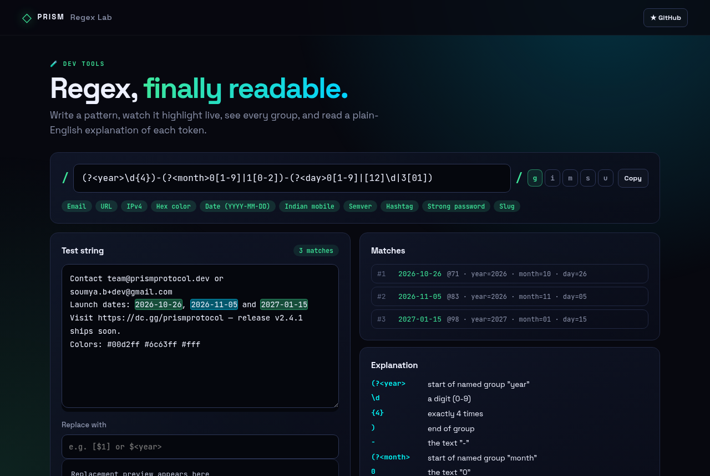
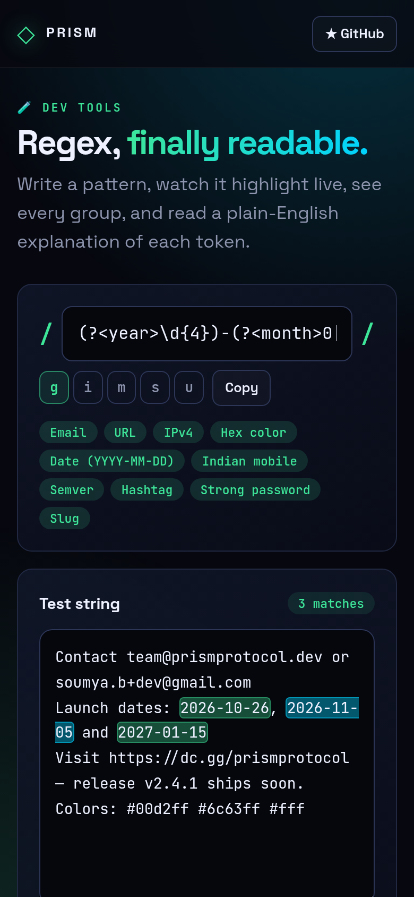

<!-- ═════════════ HEADER ═════════════ -->
<p align="center">
  
</p>

<p align="center">
  
</p>

<p align="center">
  <a href="https://github.com/krishyaa06/prism-regex-lab/actions/workflows/ci.yml"></a>
  <a href="https://krishyaa06.github.io/prism-regex-lab/"></a>
  
  
  <a href="LICENSE"></a>
</p>

<p align="center">
  
</p>


## ⚡ Overview

**Prism Regex Lab** is a JavaScript regular expression playground. Type a pattern and toggle flags; matches are highlighted directly inside the test string, every capture (including named groups) is listed with its index, and each token of the pattern is explained in plain English. A replace field previews `$1` / `$<name>` substitutions instantly.

## ✨ Features

- **Inline highlighting** of every match as you type
- **Flags**: `g`, `i`, `m`, `s`, `u` toggles
- **Match list** with index, numbered and named groups
- **Explain mode** that breaks the pattern into human-readable tokens
- **Replace preview** with `$1`, `$&` and `$<name>` support
- **Pattern library**: email, URL, IPv4, hex color, dates, Indian mobile, semver and more
- State is saved locally, copy as `/pattern/flags`

## 📸 Screenshots

<table>
  <tr>
    <td width="68%"></td>
    <td width="32%"></td>
  </tr>
</table>

## 🚀 Quick Start

**Use it online:** [https://krishyaa06.github.io/prism-regex-lab/](https://krishyaa06.github.io/prism-regex-lab/)

**Run locally:**

```bash
git clone https://github.com/krishyaa06/prism-regex-lab.git
cd prism-regex-lab
# open index.html in your browser, or serve it:
npx serve .
```

## 🛠️ Usage

1. Type a pattern between the slashes, or pick one from the library chips.
2. Toggle flags. Matches highlight in the test string.
3. Check **Matches** for groups and **Explanation** for a token-by-token breakdown.
4. Enter a replacement like `$<day>/$<month>/$<year>` to preview the output.

## 📁 Project Structure

```
prism-regex-lab/
├── assets/
│   ├── logo.png
│   └── logo.svg
├── css/
│   ├── app.css
│   └── prism.css
├── js/
│   ├── app.js   # UI wiring
│   ├── core.js   # matching, replace and explainer — tested in Node
│   └── prism.js
├── test/
│   └── core.test.js
├── .gitignore
├── LICENSE
├── README.md
├── index.html
└── package.json
```

## 🧪 Tests

```bash
npm test
```

Tests use the built-in `node:test` runner, so there is nothing to install. CI runs them on Node 20 and 22.

## 🤝 Contributing

1. Fork the repo and create a branch: `git checkout -b feature/my-idea`
2. Make your change and add a test in `test/`
3. Run `npm test` and open a Pull Request

## 🔷 Part of Prism Protocol

Prism Regex Lab is one of the open-source tools built by [Prism Protocol](https://dc.gg/prismprotocol), a tech community where young builders learn, ship and compete together.

## 👤 Author

<table>
  <tr>
    <td align="center">
      <a href="https://github.com/krishyaa06"><br><b>Soumya Bhandare</b></a><br>
      <sub>Founder @ Prism Protocol</sub>
    </td>
    <td>
      <a href="https://dc.gg/prismprotocol"></a><br>
      <a href="https://instagram.com/prism_protocol_"></a><br>
      <a href="https://x.com/krishyaa06"></a>
    </td>
  </tr>
</table>

## 📄 License

Released under the [MIT License](LICENSE).

<p align="center">
  <b>If you like this project, consider giving it a ⭐</b><br>
  <sub>"Build. Create. Compete." · Made with ⚡ by Prism Protocol</sub>
</p>


